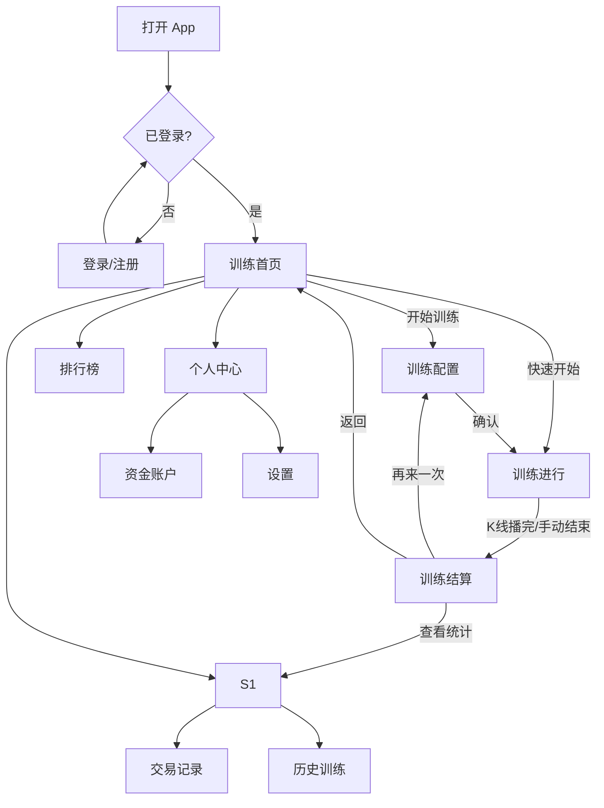

# 口袋鱼 App 产品需求文档（移动端 v1.0）

> 产品：口袋鱼 · K线训练终端
> 文档版本：v1.0　｜　日期：2026-11-06　｜　状态：待评审
> 用途：① 产品/研发需求基线；② 直接作为 AI 生成 App 页面设计稿的输入材料。

**标注约定**

| 标记 | 含义 |
|------|------|
| 【现有】 | Web 端已实现、App 可直接复用的能力与接口 |
| 【新增】 | App 端需要新开发（含后端接口） |
| 【建议】 | 推荐规则，需产品最终确认 |
| 【P1】 | 二期功能，MVP 不做 |

---

## 0. 文档使用说明（给 AI 出图的人看）

1. **第 3 章**是逐页设计需求，包含布局、元素、数据示例、交互与状态，投喂 AI 时按页拆分使用。
2. **第 7 章设计规范是硬约束**，每次出图都必须附带，否则 AI 容易生成"通用理财 App"风格。
3. **第 8 章**提供可直接复制的全局提示词与单页提示词。
4. 所有数值均为示例数据，用于设计稿占位，不必与真实接口对齐。

---

## 1. 产品定位

### 1.1 一句话定位

**用真实历史行情做逐根 K 线复盘训练，帮期货/交易学习者建立可量化的交易直觉。**

### 1.2 与 Web 端的关系

- 共用同一套后端服务（商品、K线、训练记录、交易明细、资金账户、用户体系）。
- Web 端偏"数据看板 + 图表工作站"，App 端偏"随时随地训练 + 成绩反馈 + 社交激励"。
- App 不做社区、跟单、回测、策略编辑器（Web 端已有，本期不迁移）。

### 1.3 目标用户

| 用户 | 特征 | 核心诉求 |
|------|------|----------|
| 交易新手 | 刚接触期货，缺乏盘感 | 低门槛、可回放的刻意练习；看得懂的成绩反馈 |
| 进阶交易者 | 有自己的方法，需要验证 | 按品种/周期反复训练，统计胜率、盈亏比、最大回撤 |
| 训练型用户 | 把训练当日常打卡 | 排行榜、等级、连续训练天数带来的成就感 |

### 1.4 平台与范围

| 项 | 说明 |
|----|------|
| 平台 | iOS / Android（手机优先） |
| 画布 | 竖屏 390 × 844（iPhone 14/15 基准），训练页额外支持横屏 |
| 主题 | 浅色（默认）+ 深色，跟随系统并可手动切换 |
| MVP 范围 | 登录注册、训练全流程、排行榜、训练统计、个人中心、资金账户、设置 |
| 本期不做 | 社区、跟单、历史回测、策略编辑器、会员支付【P1】 |

---

## 2. 信息架构

### 2.1 底部导航（4 Tab）

| Tab | 名称 | 一级页面 | 说明 |
|-----|------|----------|------|
| 1 | 训练 | 训练首页 | 核心入口，C 位 |
| 2 | 排行 | 排行榜 | 日/周/月/总榜 |
| 3 | 统计 | 训练统计 | 成绩汇总、收益分析、交易明细 |
| 4 | 我的 | 个人中心 | 资料、等级、资金账户、设置 |

> 训练进行页、训练结算页为全屏沉浸页，**隐藏底部 Tab**。

### 2.2 页面清单

| ID | 页面 | 入口 | 优先级 | 数据来源 |
|----|------|------|--------|----------|
| A1 | 登录 | 启动未登录 | P0 | 【现有】登录接口 |
| A2 | 注册（两步） | 登录页 | P0 | 【新增】真实注册/短信验证码 |
| T1 | 训练首页 | Tab 1 | P0 | 【现有】训练记录 + 【新增】今日聚合 |
| T2 | 训练配置 | T1「开始训练」 | P0 | 【现有】商品/合约/周期 |
| T3 | 训练进行（竖屏） | T2「开始训练」 | P0 | 【现有】K线 + 训练引擎 |
| T4 | 训练进行（横屏） | T3 旋转 | P0 | 同上 |
| T5 | 训练结算 | 训练结束 | P0 | 【现有】成绩单接口 |
| R1 | 排行榜 | Tab 2 | P0 | 【新增】排行接口 |
| R2 | 用户主页 | 榜单点击头像 | 【P1】 | 【新增】 |
| S1 | 训练统计总览 | Tab 3 | P0 | 【新增】统计聚合接口 |
| S2 | 收益分析 | S1「更多分析」 | 【P1】 | 【新增】 |
| S3 | 交易记录 | S1「查看全部」 | P0 | 【现有】交易明细分页 |
| S4 | 历史训练 | 训练首页 / 统计页 | P0 | 【现有】训练记录分页 |
| M1 | 个人中心 | Tab 4 | P0 | 【现有】用户信息 |
| M2 | 编辑资料 | M1 | P0 | 【新增】资料更新接口 |
| M3 | 资金账户 | M1 | P0 | 【现有】资金账户接口 |
| M4 | 设置 | M1 | P0 | 【现有】本地设置 + 【新增】服务端偏好 |

### 2.3 核心流程图



---

## 3. 页面级设计需求（AI 出图输入）

> 每页结构统一：**目标 → 布局 → 元素与数据 → 交互/状态 → 设计要点**。示例数据可直接用于设计稿占位。

### A1 登录页

**目标**：30 秒内完成登录，强化"训练终端"专业感。

**布局（自上而下）**
1. 品牌区：Logo（口袋鱼圆标）+「口袋鱼」+ 分隔线 +「K线训练终端」。
2. 标题：`Log in to your terminal`；副标题：`使用真实市场数据，训练你的交易直觉`。
3. 表单卡片：
   - 手机号 / 邮箱（下划线式输入框，前置图标）
   - 密码（下划线式，右侧显示/隐藏）
   - 记住我（7 天自动登录）+ 忘记密码
   - 主按钮「登录」（描边幽灵按钮，按下填充品牌蓝）
4. 分割线「或」。
5. 第三方入口：微信登录、短信登录（两个等宽描边按钮）。
6. 底部：「还没有账户？立即注册」。
7. 页脚：用户协议 / 隐私政策。

**交互/状态**：空值校验、密码错误提示条、连续 3 次失败后出现图形验证码、账号锁定提示、加载中按钮转圈。

**设计要点**：浅色主题下背景为 `#f3f4f6`，卡片纯白；不要大面积品牌色；输入框为 1px 底边线，聚焦变品牌蓝；整体窄栏居中，左右边距 24。

---

### A2 注册页（两步）

**目标**：降低注册门槛，两步完成。

**布局**
1. 顶部步骤指示器：`1 基本信息 —— 2 验证手机`（方形步骤块，非圆形）。
2. 步骤 1：昵称、手机号、密码、确认密码、协议勾选、主按钮「下一步」。
3. 步骤 2：提示"验证码已发送至 138****8888"（手机号大号等宽字体）；验证码输入 + 「发送验证码 / 60s 后重发」并排；底部「返回」+「完成注册」。
4. 底部：「已有账户？立即登录」。

**交互/状态**：实时校验；昵称 2–20 字符；手机号 11 位；密码 ≥6 位；两次密码一致；协议未勾选禁止提交；验证码 6 位。

**设计要点**：步骤块 28×28px，激活态品牌蓝描边 + 8% 填充；验证码按钮不许渐变；表单与登录页保持同一套下划线输入框。

---

### T1 训练首页（Tab 1）

**目标**：让用户 1 次点击就能开始训练，同时看到今天的训练成果。

**布局（自上而下）**
1. 顶部栏：左侧「口袋鱼」Logo + 问候语「下午好，泊远万里」；右侧通知铃铛 + 头像。
2. **今日概览卡**（白底，4 列指标）：
   - 今日训练 `3 次`
   - 今日胜率 `66.7%`
   - 今日盈亏 `+¥2,350`（红涨）
   - 连续训练 `5 天`（火苗/日历小图标）
3. **开始训练主卡**（品牌蓝 8% 底 + 蓝描边）：
   - 上次配置摘要：`螺纹钢主力 · 日线 · 近2年 · 手动播放`
   - 主按钮「继续训练 / 开始训练」（品牌蓝实心）
   - 次按钮「自定义配置」（文字按钮 → T2）
4. **训练模式**（可选卡片，2×2 或横向滑动）【P1】：
   - 随机模式 / 连续模式 / 专项训练 / 考试模式（每卡：图标 + 标题 + 一行说明）。
   - MVP 可只保留「自定义训练」一个入口。
5. **最近训练**列表（3–5 条，右滑删除【P1】）：
   - 每行：品种名 + 周期标签 + 训练日期 + 收益（红/绿）+ 收益率 + 状态（进行中/已完成）。
   - 行高 56–64px，细分隔线。
6. 底部 Tab Bar。

**交互/状态**：
- 无历史记录：主卡下方显示空态"还没有训练记录，开始你的第一次训练"。
- 有进行中的训练：主按钮变为「继续训练」，点击直接恢复（【新增】断点恢复能力，或至少恢复配置）。
- 下拉刷新今日数据。
- 未创建资金账户：点击开始时弹出「创建资金账户」引导（初始资金输入）。

**设计要点**：主按钮必须落在拇指热区；今日概览数字用等宽字体；盈亏红涨绿跌；卡片圆角 6px，不要大圆角。

---

### T2 训练配置页

**目标**：用一屏完成训练参数设置，减少输入负担。

**布局**
1. 顶部导航：返回 + 标题「训练配置」+ 右侧「重置」。
2. 表单卡片（分组）：
   - **选择商品**：搜索选择器，展示「螺纹钢主力 RB2510」，可搜索名称/编码。
   - **周期**：横向芯片组 `1分 / 5分 / 15分 / 30分 / 60分 / 日线 / 周线`，选中蓝底白字。
   - **时间范围**：起止日期选择；快捷项 `近2年 / 近5年 / 近10年`。
   - **播放方式**：分段选择器「手动 / 自动」；手动提示"每次点按播放一根K线"，自动提示"每 1 秒播放一根"。
   - **开仓手数 / 平仓手数**：步进器（最小 1）。
   - **资金账户**：显示「默认账户 · 余额 ¥108,650」，可切换。
3. 底部固定操作条：主按钮「开始训练」（全宽，品牌蓝，底部安全区留白）。

**交互/状态**：商品切换后异步拉取合约信息（手续费、每跳单价）；时间范围不能晚于今天；时间过短（少于 20 根 K 线）时提示；未选择默认账户时引导创建。

**设计要点**：表单行左标题右控件，行高 56px；分段选择器为直角小圆角，不用胶囊；数字输入用等宽字体。

---

### T3 训练进行页（竖屏，核心页）

**目标**：沉浸式逐根复盘；单手可完成「播放 / 做多 / 做空 / 平仓」。

**布局（自上而下，固定不滚动）**
1. **状态栏（两行，约 96px）**
   - 第一行：`螺纹钢主力 RB2510` · `日线` · 日期 `2025-03-12`；右侧「设置」图标 +「结束训练」文字按钮。
   - 第二行（账户条）：`权益 ¥108,650`｜`浮动盈亏 +¥2,200`（红）｜`持仓 2 手多`。
2. **K线图区（约 52% 屏高）**
   - 主图：蜡烛图 + MA5/MA10/MA20；右轴价格；底部成交量副图（约占图表 22%）。
   - 图表左上角：最新价 `3,052.0` + 涨跌幅 `+1.20%`。
   - 图表只展示**已播放**的 K 线，未来数据不可见。
3. **持仓卡（有持仓时显示，约 64px）**
   - 方向标签「多」/「空」、开仓均价、手数、浮动盈亏；可展开查看分批仓单。
4. **操作区（约 120px，拇指热区）**
   - 第一行：大号「播放下一根」按钮（全宽或 60% 宽，品牌蓝，带 `+1` 图标）。
   - 第二行三按钮等宽：`做多`（红底）、`做空`（绿底）、`平仓`（中性描边）。
   - 自动播放时：播放按钮变为「暂停」；显示 `1×` 倍速（【P1】2×/4×）。
5. **进度条（图表底部细线）**：`386 / 600 根`，右侧显示训练区间结束日期。

**交互/状态**
- 工具栏提示：训练中禁用返回手势，返回需二次确认「退出后本次训练将结束」。
- 开仓成功：轻震动 + 底部 toast「开仓 1 手，方向：多」。
- 反向开仓：toast 警告「不支持反向开仓，请先平仓」。
- 平仓手数 > 持仓：toast「平仓手数不能大于持仓手数」。
- 加载下一批 K 线：图表底部显示细进度条，不阻塞操作。
- 无持仓点平仓：toast「当前持仓数量为 0」。
- 网络异常：顶部红色提示条「行情加载失败，点击重试」。

**设计要点**：所有操作按钮 ≥ 48px 高；做多/做空颜色必须与 K 线涨跌色一致（红涨绿跌）；图表背景与页面背景同色（浅色白/深色 #16181c），网格线极淡；禁止在此页出现任何营销元素。

---

### T4 训练进行页（横屏）

**目标**：最大化图表视野，接近桌面终端体验。

**布局**
1. 左侧/主区：全屏 K 线 + 成交量（占 100% 高度）。
2. 顶部悬浮条：合约、周期、日期、最新价、涨跌幅、训练进度、退出。
3. 右侧竖排操作栏（宽约 88px，悬浮半透明面板）：
   - 「播放」圆形主按钮
   - 「做多」红 / 「做空」绿 / 「平仓」中性，纵向排列
   - 开仓/平仓手数步进器（紧凑）
4. 左下角持仓浮层：方向、均价、手数、浮盈。
5. 横屏时隐藏底部 Tab Bar 与系统状态栏（沉浸模式）。

**交互/状态**：与 T3 完全一致；旋转时训练状态不丢失；锁定横屏开关（【P1】）。

**设计要点**：横屏图表避免被操作栏遮挡关键价格轴；操作栏可收起为悬浮球（【P1】）。

---

### T5 训练结算页（成绩单）

**目标**：给出一份"看得懂、愿意分享"的训练成绩单。

**布局**
1. 顶部结果横幅：
   - 大标题「训练完成」/「训练中止」
   - 本次收益 `+¥3,280`（大号、红/绿）+ 收益率 `+3.28%`
   - 品种 · 周期 · 时间区间 · 用时
2. **核心指标网格（2×3）**
   - 交易次数 `12`
   - 胜率 `66.7%`
   - 盈亏比 `2.10`
   - 最大单笔盈利 `+¥1,860`
   - 最大单笔亏损 `-¥640`
   - 总手续费 `¥96`
3. **权益曲线**：从初始权益到结束权益的小型折线/面积图（可用示例曲线）。
4. **交易明细摘要**：最近 3 笔平仓记录（方向、开平价、手数、盈亏），底部「查看全部」。
5. **底部双按钮**：`再来一次`（次要描边）/ `查看统计`（主按钮）。
6. 角落：「分享成绩单」图标（【P1】生成海报）。

**交互/状态**：存在未平仓持仓时结束训练，需确认弹窗「当前仍有 2 手持仓，结束后将按最后价格结算」；数据加载中骨架屏；无任何交易时显示空态「本次训练没有交易，下次试试下单吧」。

**设计要点**：数字必须等宽对齐；收益正负用红/绿；成绩单整体像"体检报告"，信息密度高、留白克制；可生成竖版海报（【P1】）。

---

### R1 排行榜（Tab 2）

**目标**：用轻社交激励驱动持续训练。

**布局（自上而下）**
1. 顶部标题「排行榜」+ 副标题「全站用户训练战绩排名」。
2. 周期切换（分段控件）：`日榜 / 周榜 / 月榜 / 总榜`。
3. **前三名领奖台**：中间第 1 名最高最大（头像 80px + 金色描边），左右第 2/3 名（头像 64px）略低。
   - 每名展示：头像、昵称、胜率、周期收益率、收益金额。
4. **榜单列表（4–100 名）**：
   - 每行：名次（前 10 名品牌蓝）、头像、昵称、胜率、周期收益率、收益额。
   - 行高 64px，细分隔线，rownum 等宽字体。
5. **我的排名卡（吸底，悬浮于 Tab Bar 之上）**：
   - 名次 `56`、头像、昵称 +「我」标签、胜率、我的周期收益。
   - 背景品牌蓝 8%，蓝色描边。
6. 底部 Tab Bar。

**交互/状态**：周期切换重新拉取；下拉刷新；未上榜显示「暂未上榜，完成 1 次训练即可参与」；榜单为空显示空态插图（线性图标风格，不用彩色插画）；点击用户进入 R2【P1】。

**设计要点**：领奖台只使用金/银/铜三种低饱和强调色，其余保持中性；收益正负红绿；不在榜单使用渐变；顶部周期切换为直角分段控件。

---

### S1 训练统计（Tab 3）

**目标**：让用户一眼看清"我练得怎么样"，并能下钻到明细。

**布局（自上而下）**
1. 顶部标题「训练统计」+ 右侧时间筛选（近7天/近30天/近90天/全部）。
2. **核心指标卡（2×2）**：
   - 累计训练 `128 次`
   - 累计盈亏 `+¥25,800`（红）
   - 胜率 `65.5%`
   - 总手续费 `¥1,280`
3. **收益曲线卡**：累计收益折线/面积图（品牌蓝线，浅蓝面积），X 轴日期，Y 轴金额；右上角显示区间收益。
4. **品种分布卡**：横向条形（螺纹钢 32%、沪深300 24%、原油 18%、黄金 14%、其他 12%），单一蓝色系由深到浅，右侧百分比。
5. **交易习惯卡（【P1】）**：持仓时间、日均交易次数、止损执行率、计划执行率（进度条）。
6. **最近交易**列表：最近 5 条，行内展示品种、方向标签、开平价、盈亏；右上「查看全部」→ S3。
7. **历史训练入口**：「查看全部训练记录」→ S4。
8. 底部 Tab Bar。

**交互/状态**：切换时间范围刷新全部卡片；数据不足时曲线区显示空态「完成首次训练后展示」；指标定义可点击 `?` 弹出解释。

**设计要点**：卡片间距 12px；数字字号 24–28px 等宽；不要雷达图、仪表盘等花哨图表；整体是"报表"而非"仪表盘"。

---

### S2 收益分析（【P1】）

**目标**：进阶分析，满足重度用户。

**布局**：时间/账户筛选 → 关键指标（夏普比率、最大回撤、盈亏比、日均收益）→ 月度收益柱状图（盈利红、亏损绿）→ 星期收益分布 → 交易习惯进度条 → 方向胜率对比。

**设计要点**：图表保持单色系 + 红绿语义色；不引入第三种强调色。

---

### S3 交易记录

**目标**：可检索、可核对的交易流水。

**布局**
1. 顶部导航：返回 + 「交易记录」+ 筛选图标。
2. 筛选条（横向滚动芯片）：账户、时间范围、方向（多/空）、盈亏（盈利/亏损）。
3. 汇总条：`共 128 笔 · 盈利 84 · 亏损 44 · 总盈亏 +¥25,800`。
4. 列表（每行两行式卡片）：
   - 第一行：品种名 + 方向标签（多=红、空=绿）+ 日期时间
   - 第二行：开仓价 → 平仓价 · 手数 · 盈亏金额（红/绿）· 收益率
5. 分页：上拉加载更多（每页 20 条）。
6. 点击行 → 交易详情抽屉（含所属训练、手续费、结算明细）。

**交互/状态**：空态「没有符合条件的交易记录」；加载失败可重试；筛选项可一键清除。

**设计要点**：列表行信息密度高，但必须保持两行结构；价格与盈亏使用等宽字体；方向标签用色块+文字，不要只用颜色区分（无障碍）。

---

### S4 历史训练

**目标**：回看每一次训练的结果，支持删除。

**布局**
1. 顶部导航：返回 + 「训练记录」。
2. 筛选：状态（全部/进行中/已完成）、品种、日期。
3. 列表卡片（每卡）：
   - 标题行：品种 + 周期标签 + 状态标签
   - 第二行：训练时间区间、初始资金 → 结束资金
   - 第三行：收益金额（红/绿）、收益率、交易次数
   - 右滑操作：删除（红色）。
4. 点击卡片 → 训练详情（复用 T5 成绩单布局的只读版）。
5. 上拉加载更多。

**交互/状态**：删除二次确认；进行中的训练显示「继续训练」按钮。

**设计要点**：与 T5 成绩单视觉一致；状态标签用低饱和底色。

---

### M1 个人中心（Tab 4）

**目标**：账户、资产、成就的总入口。

**布局（自上而下）**
1. **个人信息头**：
   - 头像（72px，右下角相机小按钮）
   - 昵称 + VIP 标签
   - `ID 885234`（等宽字体）
   - 个性签名
   - 右侧「编辑资料」描边按钮
2. **等级卡**：`LV.5 训练达人`，经验条 `320 / 500`，下一等级提示。
3. **数据行（3 列）**：训练天数 `128`｜总训练 `128 次`｜最高排名 `56 名`。
4. **菜单分组（白底卡片，分组间 12px）**：
   - 训练：历史训练、交易记录、我的成就【P1】
   - 资产：资金账户（显示默认账户余额）、资金调拨【P1】
   - 服务：会员套餐【P1】、系统设置、帮助与反馈
5. **退出登录**（红色文字按钮，底部）。
6. 底部 Tab Bar。

**交互/状态**：头像上传（【P1】或 MVP 仅支持预设头像）；未登录不应出现此页（由登录守卫拦截）。

**设计要点**：头部不做大图背景，保持白底/深色面板；菜单行高 52px，左侧线性图标统一 20px；信息密度适中，留白清晰。

---

### M2 编辑资料

**布局**：头像更换 → 昵称（2–20 字）→ 手机号（只读，可更换）→ 邮箱 → 个性签名（200 字，显示字数）→ 底部「保存修改」。
**交互**：仅修改后允许保存；保存成功 toast + 返回；失败保留输入。

---

### M3 资金账户

**目标**：管理训练使用的模拟资金账户。

**布局**
1. 顶部导航：返回 + 「资金账户」。
2. 账户卡列表（每卡）：
   - 账户名 + 「默认」标签
   - 余额（大号等宽，`¥108,650.00`）
   - 最近更新时间
   - 操作：设为默认、编辑、删除（红色）。
3. 底部固定按钮「新建账户」。
4. 新建/编辑弹层：账户名称、初始金额（数字键盘）。

**交互/状态**：删除默认账户需二次确认，且至少保留一个账户；无账户时全屏引导创建（与训练开始前的引导一致）。

**设计要点**：余额是页面视觉重点；卡片不要用渐变金卡；金额保留两位小数、千分位。

---

### M4 设置

**布局（分组列表）**
1. 通用：深色模式（跟随系统/浅色/深色 三选一）、界面语言（【P1】）、时区（【P1】）。
2. 通知：交易提醒、账户变动、社区消息（【P1】）、邮件通知。
3. 训练偏好：默认周期、默认播放方式、默认开仓手数、K线样式（蜡烛/美式线/折线）。
4. 安全：修改密码、两步验证【P1】、登录设备管理【P1】、账户注销（红色）。
5. 关于：版本号、用户协议、隐私政策、清除缓存。
6. 退出登录。

**交互/状态**：开关即时保存（本地 + 服务端【新增】）；重要操作二次确认；注销需输入验证码并明确风险。

**设计要点**：标准 iOS/Android 设置页结构；分组标题小号灰字；危险操作使用语义红。

---

## 4. 重点模块

| 模块 | 职责 | 关键依赖 | 优先级 |
|------|------|----------|--------|
| 训练引擎 | 创建训练、K线分批加载、逐根播放、开/平仓、实时盈亏 | 行情接口、交易接口、资金账户 | P0 |
| 行情图表 | K线渲染、指标线、成交量、手势缩放/拖动、横竖屏 | 商品/周期、K线数据 | P0 |
| 交易模拟 | 开平仓规则、手续费、部分平仓、盈亏结算 | 训练引擎、合约配置 | P0 |
| 成绩统计 | 单次训练成绩单、跨训练聚合统计 | 交易明细、训练记录 | P0（单次）/ P0（聚合，新增） |
| 排行系统 | 日/周/月/总榜、我的排名 | 训练记录、用户资料 | P0（新增） |
| 用户与账户 | 登录注册、资料、资金账户、设置 | 认证服务、资金账户 | P0 |
| 激励体系 | 等级/经验、成就、连续训练 | 统计聚合 | P1 |
| 消息通知 | 训练结束、账户变动推送 | 推送服务 | P1 |

**模块关系**：训练引擎是核心，行情与交易是它的两个能力臂；成绩统计消费训练与交易数据；排行消费统计结果；用户与账户为所有模块提供身份与资金上下文。

---

## 5. 核心功能业务逻辑

> 以下规则以现有 Web 端实现为准（`TrainCore.js`、`BUSINESS_RULES.md`、服务端 `UserTrain*`）。

### 5.1 训练状态机

```
READY(0) ──开始训练──▶ RUNNING(1) ──K线播完/手动结束──▶ FINISH(-1)
```

| 状态 | 值 | 说明 |
|------|-----|------|
| READY | 0 | 已创建参数，尚未开始播放 |
| RUNNING | 1 | 播放中，可开/平仓 |
| FINISH | -1 | 已结束，进入成绩单 |

- 创建训练时后端写入 `status = 1`（直接进入进行中）。
- 训练结束后 `PUT /userTrain` 更新 `status = -1`。
- 【建议】App 增加"断点恢复"：保存当前播放进度与持仓，重新进入可继续；MVP 可先只恢复配置。

### 5.2 训练创建参数【现有】

| 字段 | 说明 | 示例 |
|------|------|------|
| fundId | 资金账户 ID | 10001 |
| goodCode | 商品编码 | RB |
| symbol | 主力合约 | RB2510 |
| period | 周期 key | D / 1m / 5m / 15m / 30m / 60m |
| status | 状态 | 1 |
| startTime / finishTime | K线训练区间 | 2024-11-06 ~ 2026-11-06 |
| serCharge | 手续费单价（快照） | 2.5 |
| unitPrice | 每跳单价（快照） | 10 |

- 创建时后端读取资金账户余额，写入 `firstAmount` 与 `finishAmount`。
- 合约信息（手续费、每跳单价、计算方式）通过 `POST /userTrain/SymbolInfo` 获取。

### 5.3 K线加载与播放【现有】

1. **分批加载**：按训练区间分页拉取，单批根数按周期配置（1 分钟约 2000 根、5 分钟约 400 根、15 分钟约 133 根、30 分钟约 67 根、60 分钟约 33 根、日线约 20 根）。
2. **首屏预载**：首批数据一分为二，前半立即绘制（提供历史上下文），后半进入"待播放队列"。
3. **逐根播放**：
   - 手动：用户每次点按「播放下一根」推进一根（Web 快捷键 `S`）。
   - 自动：每 1 秒推进一根。
4. **批次衔接**：待播放队列耗尽时，以最后一根时间戳为起点加载下一批；直到到达训练区间终点。
5. **结束**：队列耗尽且到达终点 → 状态置为 FINISH → 拉取成绩单 → 展示 T5。
6. **规则**：图表只展示已播放数据；回看历史不消耗播放进度；训练中不可切换商品/周期。

### 5.4 开仓规则【现有】

| 规则 | 说明 |
|------|------|
| 开仓价 | 当前已播放最后一根 K 线的收盘价 |
| 方向 | 做多 +1 / 做空 -1 |
| 手数 | 使用配置的开仓手数（App 可在训练中临时调整） |
| 反向开仓 | **禁止**：持有多单时不能开空单，反之亦然；提示"不支持反向开仓，请先平仓" |
| 同一根 K 线重复开仓 | 不新建仓单，**手数累加**到最后一笔持仓 |
| 不同 K 线开仓 | 新建一笔持仓单 |
| 手续费 | 开仓时按手数收取并记录到该笔持仓 |
| 落库 | 每次开仓调用 `POST /userTrainDtl/open`，返回 `trdId` |

**边界**：余额不足目前未校验（Web 端 TODO），App 端【建议】在开仓前校验可用资金并给出提示。

### 5.5 平仓规则【现有】

| 规则 | 说明 |
|------|------|
| 平仓价 | 当前最后一根 K 线收盘价 |
| 手数限制 | 平仓手数 ≤ 当前持仓手数，否则提示 |
| 无持仓 | 提示"当前持仓数量为 0" |
| 部分平仓 | 支持；按**开仓顺序（FIFO）**分配，先平最早持仓 |
| 开仓均价 | 若一次平仓跨多笔持仓，按各笔手数加权计算平均开仓价 |
| 方向 | 取第一笔被平仓单的方向 |
| 手续费 | 平仓时再收一次；收益中同时扣除对应开仓手续费 |
| 落库 | `POST /userTrainDtl/close` 提交结算单 + 被平仓明细，返回更新后的资金账户 |

**平仓后处理**：本地删除已平仓的仓单与结算单；账户余额更新为服务端返回值。

### 5.6 盈亏与手续费公式【现有】

**持仓浮动盈亏（每根 K 线刷新）**

```
多头：浮盈 = (最新收盘价 - 开仓价) × 未平手数 × 每跳单价
空头：浮盈 = (开仓价 - 最新收盘价) × 未平手数 × 每跳单价
总浮盈 = Σ 所有持仓单
持仓手数 = Σ (开仓手数 - 已平手数)
浮动收益率 = 总浮盈 ÷ 持仓金额 × 100%（持仓金额 = Σ 开仓价 × 未平手数）
```

**平仓已实现收益**

```
收益 = 方向系数 × (平仓价 - 平均开仓价) × 平仓手数 × 每跳单价
       - 平仓手续费 - 对应开仓手续费分摊
方向系数：多 = +1，空 = -1
```

**手续费**

```
按比例（serCalcType = P）：单手手续费 = 手续费单价 × 成交价
按固定值（serCalcType = F）：单手手续费 = 手续费单价
开仓和平仓各收一次
```

**资金联动**

```
平仓收益直接加到资金账户余额；训练记录的 finishAmount 同步更新为账户最新余额
本次训练收益 = finishAmount - firstAmount
```

### 5.7 训练结束与成绩单【现有接口 + 派生】

`GET /userTrainDtl/summary/{traId}` 返回：

| 字段 | 含义 | 说明 |
|------|------|------|
| firstAmount | 期初金额 | 创建训练时的账户余额 |
| finishAmount | 期末金额 | 最近一次平仓后的账户余额 |
| totalProfit | 总收益 | `finishAmount - firstAmount` |
| totalLoss | 总亏损 | 所有亏损平仓单收益之和（负数） |
| maxProfit | 最大单笔盈利 | 盈利平仓单的最大值 |
| maxLoss | 最大单笔亏损 | 亏损平仓单的最小值（负数） |
| totalFee | 总手续费 | 所有明细手续费之和 |
| openTimes | 开仓次数 | `type = 0` 的条数 |
| profitTimes | 盈利平仓次数 | `type = 1 且 income ≥ 0` |
| lossTimes | 亏损平仓次数 | `type = 1 且 income < 0` |

**App 端派生指标**

```
胜率 = profitTimes ÷ (profitTimes + lossTimes) × 100%
交易次数 = profitTimes + lossTimes（平仓次数）
收益率 = totalProfit ÷ firstAmount × 100%
```

**需后端补充**：`盈亏比`（当前 VO 有字段但 SQL 未计算）【新增】；`最大回撤`、`夏普比率`（S2 使用）【新增】。

> 已知实现细节：开仓手续费在平仓分摊时按"仓单汇总手续费 × 平仓手数"计算，与"单手手续费 × 手数"口径可能不一致。App 端展示口径统一按服务端返回值，不自行重算；【建议】后端修正后同步。

### 5.8 资金账户逻辑【现有】

- 每个用户至少一个资金账户，`isDefault = true` 的为默认账户。
- 训练必须绑定一个账户；进入训练页时拉取默认账户，不存在则引导创建。
- 平仓收益实时累加到账户余额；账户余额跨训练共享。
- 账户字段：`id / userId / accName / amount / isDefault / updateTime`。

### 5.9 排行榜规则【新增·建议】

| 规则 | 建议方案 |
|------|----------|
| 榜单周期 | 日榜（自然日）/ 周榜（周一起）/ 月榜（自然月）/ 总榜 |
| 排名指标 | **周期累计收益率**（消除初始资金差异）；并列时按胜率、再按训练次数 |
| 参与门槛 | 周期内完成 ≥ 5 次训练，且有效平仓 ≥ 10 笔 |
| 有效训练 | `status = -1`，且非删除、非异常数据 |
| 展示内容 | 名次、头像、昵称、胜率、周期收益率、周期收益额 |
| 更新频率 | 训练结束时异步更新；榜单每 5 分钟缓存刷新 |
| 我的排名 | 未上榜展示"暂未上榜"；上榜后吸底展示 |
| 防刷 | 同一用户只取最高成绩；过滤同一训练重复统计；异常收益率人工审核 |

> 当前后端无排行榜接口与聚合表，需新增。设计稿阶段可使用示例数据。

### 5.10 统计口径【新增聚合】

| 指标 | 口径 |
|------|------|
| 累计训练次数 | 用户所有已完成训练数（可按时间范围过滤） |
| 累计交易笔数 | 所有平仓单数 |
| 胜率 | 盈利平仓单 ÷ 平仓单总数 |
| 累计盈亏 | Σ 每次训练的 `totalProfit` |
| 总手续费 | Σ 每次训练的 `totalFee` |
| 收益曲线 | 按训练完成时间排序的累计收益 |
| 品种分布 | 按训练商品的训练次数或交易笔数占比 |
| 最大回撤 | 收益曲线峰值到谷底的最大跌幅（S2） |
| 盈亏比 | 平均盈利 ÷ 平均亏损（S2） |

### 5.11 异常与边界

| 场景 | 处理 |
|------|------|
| K线加载失败 | 顶部提示条 + 重试，不结束训练 |
| 开仓/平仓接口失败 | toast 失败原因，本地状态回滚 |
| 平仓返回空账户 | 提示"操作失败"，不改变本地余额 |
| 训练区间过短 | 配置页拦截，提示至少 20 根 K 线 |
| 中途退出 App | 训练作废或断点保存（待定）；建议提示"退出将结束训练" |
| 多端同时训练 | 以服务端训练记录为准，App 端提示"存在进行中的训练"（【新增】） |
| 账户被删除 | 进入训练前重新拉取默认账户 |

---

## 6. 接口现状与 App 端改造点

### 6.1 可直接复用【现有】

| 能力 | 方法 | 路径 |
|------|------|------|
| 登录 | POST | `/login`（认证模块） |
| 当前用户 | GET | `/getInfo`（认证模块） |
| 商品搜索 | GET | `/goodsInfo/search?searchValue=` |
| 商品详情 | GET | `/goodsInfo/{id}` |
| K线数据 | GET | 行情接口（按 symbol/period/from/to） |
| 合约配置 | POST | `/userTrain/SymbolInfo` |
| 创建训练 | POST | `/userTrain` |
| 更新训练（结束） | PUT | `/userTrain` |
| 训练详情 | GET | `/userTrain/{id}` |
| 训练分页 | GET | `/userTrain/page` |
| 删除训练 | DELETE | `/userTrain/{id}` |
| 开仓 | POST | `/userTrainDtl/open` |
| 平仓 | POST | `/userTrainDtl/close` |
| 训练成绩单 | GET | `/userTrainDtl/summary/{traId}` |
| 交易明细分页 | GET | `/userTrainDtl/page` |
| 资金账户列表 | GET | `/fundAccount/list` |
| 默认资金账户 | GET | `/fundAccount/default` |
| 创建/更新账户 | POST / PUT | `/fundAccount` |
| 删除账户 | DELETE | `/fundAccount/{id}` |

### 6.2 App 端必须新增

| 能力 | 建议接口 | 说明 |
|------|----------|------|
| 排行列表 | GET `/leaderboard?period=day|week|month|all` | 榜单 + 我的排名 |
| 统计聚合 | GET `/userTrain/statistics?range=30d` | 跨训练汇总、收益曲线、品种分布 |
| 今日概览 | GET `/userTrain/today` | 今日训练次数/胜率/盈亏/连续天数 |
| 资料更新 | PUT `/user/profile` | 昵称、头像、邮箱、签名 |
| 用户偏好 | GET/PUT `/user/preferences` | 通知、主题、训练默认值 |
| 断点恢复 | GET/PUT `/userTrain/{id}/progress` | 【P1】播放进度与持仓 |
| 真实注册 | POST `/register` + 短信验证码 | Web 端注册目前为前端模拟 |

### 6.3 现状风险（仅记录，本次不改后端）

- `/userTrain/page`、`/userTrainDtl/page`、`/userTrainDtl/list` 当前**未按当前用户过滤**，App 上线前必须由后端补齐用户维度过滤，否则存在越权读取风险。
- 训练汇总中 `profitLossRatio` 未计算，前端展示需后端补字段。
- 结束训练时 `status` 更新依赖前端调用 `PUT`，App 端需保证失败重试，避免产生"永远进行中"的记录。

---

## 7. 设计规范（AI 出图硬约束）

### 7.1 设计语言

**金融终端风**：高信息密度、小圆角、细分隔线、等宽数字、克制的色彩。参考"专业交易软件"，而不是"互联网理财 App"。

### 7.2 色彩令牌

| 令牌 | 浅色（默认） | 深色 |
|------|--------------|------|
| 页面背景 `app` | `#f3f4f6` | `#121212` |
| 卡片 `panel` | `#ffffff` | `#16181c` |
| 次级卡片 `panel-raised` | `#f9fafb` | `#1b1d22` |
| 主文字 `ink` | `#111827` | `#e8eaed` |
| 次文字 `ink-secondary` | `#374151` | `#9aa0a6` |
| 弱文字 `ink-faint` | `#6b7280` | `#5f6469` |
| 分割线 `line` | `rgba(17,24,39,0.08)` | `rgba(255,255,255,0.08)` |
| 强分割线 `line-strong` | `rgba(17,24,39,0.16)` | `rgba(255,255,255,0.18)` |
| 品牌蓝 `primary` | `#2962ff` | `#2962ff` |
| 品牌蓝悬停 | `#1f4fd6` | `#1f4fd6` |
| 链接 `link` | `#1f4fd6` | `#5c8fff` |
| **上涨/盈利（红）** | `#e0535b` | `#e0535b` |
| **下跌/亏损（绿）** | `#2ba471` | `#2ba471` |
| 警示 | `#e6a23c` | `#e6a23c` |

> **铁律：中国市场红涨绿跌。** 盈利、上涨、做多用红；亏损、下跌、做空用绿。做多按钮=红，做空按钮=绿。禁止 AI 默认成"绿涨红跌"。
> K 线图可用更饱和的 `#F92855`（涨）/ `#2DC08E`（跌）提升可读性，语义与上表一致。

### 7.3 字体与数字

- 中文：PingFang SC / 系统字体；英文：Inter / 系统字体。
- 数字：Roboto Mono / JetBrains Mono，**必须启用等宽数字**（tabular-nums），用于价格、金额、百分比、排名。
- 字号阶梯：28 / 24 / 20 / 17 / 15 / 13 / 11。
- 字重：正文 400，强调 500，数字标题 600，不使用 700+ 粗黑。

### 7.4 布局与间距

- 8pt 栅格；页面左右边距 16；卡片内边距 16；卡片间距 12；列表行高 52–64。
- 圆角：控件 4px，卡片 6px，头像/标签可全圆；**禁止 > 8px 的大圆角**。
- 底部 Tab Bar 高 56 + 安全区；训练页操作按钮高 ≥ 48。
- 提供 iPhone 14（390×844）与 Android（360×800）两套基准。

### 7.5 组件规范

| 组件 | 规范 |
|------|------|
| 主按钮 | 品牌蓝实心，白字，4px 圆角，高 44–48 |
| 次按钮 | 透明底 + 1px 边框，文字品牌蓝 |
| 危险操作 | 文字红 / 描边红，仅在确认弹窗中使用红底 |
| 卡片 | 白底 1px 边线（`line`），6px 圆角，无阴影或极轻阴影 |
| 标签 | 12px 字号，4px 圆角，低饱和底色（方向：多=红 8%，空=绿 8%） |
| 分段控件 | 直角小圆角，选中项白底/深色 raised 底 + 主文字，未选中弱文字 |
| 输入框 | 浅色底 + 1px 边线；登录页可用下划线式 |
| 空态 | 线性图标 + 一句说明 + 一个操作按钮；不使用彩色插画 |
| Tab Bar | 线性图标 24px，选中品牌蓝，未选中弱文字；4 个 Tab |

### 7.6 图表规范

- 蜡烛图：红涨绿跌；阳线红、阴线绿；网格线极淡（`line`），虚线。
- 主图 + 成交量副图；均线使用低饱和黄/紫/蓝，最多 3 条。
- 十字光标：细虚线 + 数值气泡（深色底浅色字）。
- 收益曲线：品牌蓝线 + 8% 透明面积；柱状图按正负使用红/绿。
- 图表内不使用渐变背景、发光、3D。

### 7.7 移动端交互

- 拇指热区：核心操作放在屏幕下方 1/3。
- 图表手势：双指缩放、单指拖动回看、长按十字光标；不与页面滚动冲突。
- 反馈：开/平仓成功轻震动 + toast；危险操作二次确认；加载用骨架屏而非全屏转圈。
- 主题：浅色为默认；所有页面需同时交付浅色稿，核心页（训练、成绩单、首页）额外交付深色稿。
- 安全区：所有固定底栏适配 Home Indicator。

### 7.8 禁止事项

- ❌ 绿涨红跌；❌ 大面积渐变、玻璃拟态、霓虹发光；❌ 大圆角胶囊卡片；❌ 彩色 3D 插画；❌ 每页超过 2 种强调色；❌ 营销 Banner 挤占训练入口。

---

## 8. AI 出图提示词

### 8.1 全局风格提示词（每次出图先附上）

```text
请设计一款中国期货 K 线训练 App 的页面，产品名「口袋鱼」，金融终端风格。
平台：iOS/Android 手机，画布 390×844，状态栏与底部安全区完整。
风格：专业、克制、高信息密度；白底卡片 + 极细分割线 + 小圆角（4–6px）；无渐变、无玻璃拟态、无 3D 插画、无大圆角胶囊。
色彩：品牌蓝 #2962ff；页面背景 #f3f4f6；卡片 #ffffff；主文字 #111827；次文字 #374151；弱文字 #6b7280；分割线 rgba(17,24,39,0.08)。
【重要】中国市场习惯：上涨/盈利/做多用红色 #e0535b，下跌/亏损/做空用绿色 #2ba471，严禁绿涨红跌。
数字使用等宽字体（Roboto Mono），千分位与两位小数规范；中文界面；图标使用线性图标。
请输出浅色主题；训练页、成绩单、首页额外输出深色主题（背景 #121212，卡片 #16181c，主文字 #e8eaed）。
```

### 8.2 单页提示词（在全局提示词后追加）

| 页面 | 追加提示词 |
|------|-----------|
| 登录 | `登录页：品牌 Logo「口袋鱼」+ K线训练终端，下划线式输入框（手机号/邮箱、密码），描边主按钮「登录」，微信/短信登录两个描边按钮，底部注册入口；窄栏居中，左右留白 24。` |
| 注册 | `注册页两步流程：顶部方形步骤指示器；第一步昵称/手机号/密码/确认密码/协议；第二步显示掩码手机号、验证码输入与 60s 重发按钮、返回与完成注册。` |
| 训练首页 | `训练首页：顶部问候与头像；今日概览四指标（训练次数/胜率/盈亏/连续天数）；蓝色描边主卡显示上次训练配置与「开始训练」大按钮；下方最近训练列表（品种、周期标签、日期、红绿收益）；底部 4 Tab。` |
| 训练配置 | `训练配置页：商品搜索选择、周期横向芯片组、时间范围与近2/5/10年快捷项、手动/自动分段选择、开仓/平仓手数步进器、资金账户行；底部固定全宽「开始训练」按钮。` |
| 训练进行（竖屏） | `训练进行页竖屏：顶部合约/周期/日期与结束训练；账户条显示权益、浮动盈亏（红）、持仓手数；中部 52% 高度 K 线图（蜡烛+均线+成交量，红涨绿跌，只显示已播放K线）；持仓卡；底部拇指区：大按钮「播放下一根」，下方等宽三按钮「做多（红）」「做空（绿）」「平仓（描边）」；底部细进度条 386/600 根。` |
| 训练进行（横屏） | `同一训练页的横屏版本：全屏 K 线与成交量，顶部悬浮状态条，右侧竖排悬浮操作栏（播放/做多红/做空绿/平仓），左下角持仓浮层，禁止出现底部 Tab。` |
| 训练结算 | `训练成绩单：顶部大号本次收益（红）与收益率；2×3 指标网格（交易次数、胜率、盈亏比、最大盈利、最大亏损、总手续费）；权益曲线小图；最近3笔平仓记录；底部「再来一次」描边与「查看统计」主按钮。像体检报告，信息密度高。` |
| 排行榜 | `排行榜页：顶部日/周/月/总分段切换；前三名领奖台（第一名头像 80px 居中最高，二三名 64px 略低，金银铜低饱和描边）；4–100 名列表（名次、头像、昵称、胜率、周期收益率、收益额）；底部吸底「我的排名」蓝色浅底卡片；底部 4 Tab。` |
| 训练统计 | `训练统计页：顶部时间筛选；2×2 核心指标卡（训练次数、累计盈亏红、胜率、总手续费）；累计收益折线面积图；品种分布横向条形（单一蓝色系）；最近交易列表与「查看全部」；历史训练入口；底部 4 Tab。` |
| 交易记录 | `交易记录页：筛选芯片（账户/时间/方向/盈亏）与汇总条；列表每行两行式：品种+多/空标签+时间；开仓价→平仓价·手数·红绿盈亏·收益率；上拉加载；点击进入详情。` |
| 历史训练 | `训练记录页：状态/品种/日期筛选；卡片列表显示品种+周期标签+状态标签、区间与初始/结束资金、红绿收益与交易次数；进行中训练显示「继续训练」。` |
| 个人中心 | `个人中心：头像 72px 与相机按钮、昵称+VIP标签、等宽 ID、签名、编辑资料按钮；LV.5 等级卡与经验条；三列数据（训练天数/总训练/最高排名）；分组菜单（历史训练、交易记录、资金账户、设置、帮助）；底部红字退出登录；底部 4 Tab。` |
| 资金账户 | `资金账户页：账户卡片列表（账户名+默认标签、大号余额、更新时间、设为默认/编辑/删除）；底部固定「新建账户」按钮；空态引导创建。` |
| 设置 | `设置页：分组列表（通用/通知/训练偏好/安全/关于），深色模式与训练默认值使用开关或选择行；危险操作红色；标准系统设置页布局。` |

---

## 9. MVP 与迭代

### MVP（v1.0，设计稿必须覆盖）

登录注册 → 训练首页 → 训练配置 → 训练进行（竖屏+横屏）→ 训练结算 → 排行榜 → 训练统计总览 → 交易记录 → 历史训练 → 个人中心 → 资金账户 → 设置。

### 二期（v1.1+）

收益分析（S2）、用户主页（R2）、等级与成就体系、会员套餐、消息推送、成绩单海报分享、断点恢复、横屏锁定/倍速播放。

### 三期（探索）

社区、跟单、策略编辑器移动化、赛事/专项训练营。

---

## 10. 验收标准

### 功能验收

- [ ] 训练全链路可完成：创建 → 播放 → 开仓 → 平仓 → 结束 → 成绩单数据与服务端一致。
- [ ] 开仓三条规则（禁反向、同K线累加、新建仓单）通过测试。
- [ ] 平仓规则（手数上限、部分平仓 FIFO、加权均价、双边手续费）通过测试。
- [ ] 账户余额与训练收益联动正确，跨训练累计无误。
- [ ] 排行榜周期切换、我的排名、空态、下拉刷新正常。
- [ ] 统计指标与明细可下钻，筛选与分页正确。
- [ ] 浅色/深色主题切换与跟随系统正常；训练页横竖屏状态不丢失。

### 设计验收

- [ ] 全部页面遵守第 7 章色彩、圆角、字号、密度规范。
- [ ] 红涨绿跌全局一致（含按钮、标签、图表、列表）。
- [ ] 数字全部等宽、千分位、两位小数。
- [ ] 每页提供默认态、加载态、空态、错误态。
- [ ] 核心页（训练进行、成绩单、训练首页）提供深色稿。
- [ ] 所有底部固定操作适配安全区。

---

## 11. 待确认问题

1. 排行榜主指标用「收益率」还是「收益额」？参与门槛（5 次训练）是否合理？
2. 训练中途退出：作废还是断点保存？MVP 是否必须支持恢复？
3. 余额不足是否需要拦截开仓？初始资金是否有上下限？
4. 注册是否必须短信验证？是否保留微信登录？
5. App 端是否需要"训练模式"（随机/连续/专项/考试），还是只保留自定义训练？
6. 会员体系（VIP 标签、付费功能）是否纳入 v1.0？
7. K线图在 App 端采用原生绘制还是内嵌 Web 图表（klinecharts）？需在技术方案阶段定稿。
